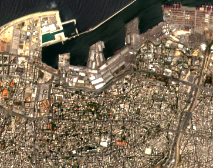
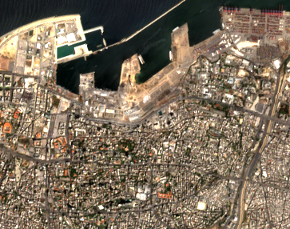
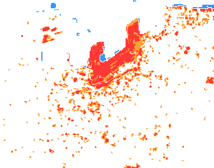
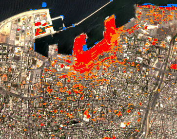
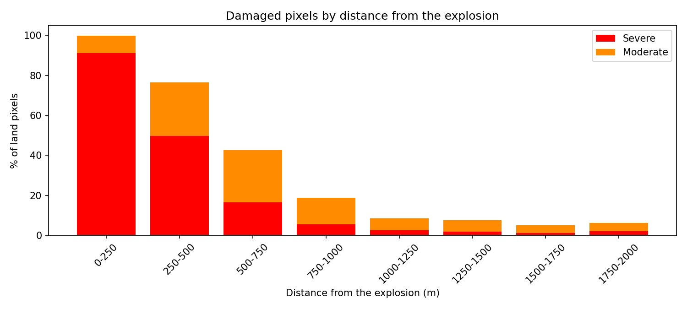
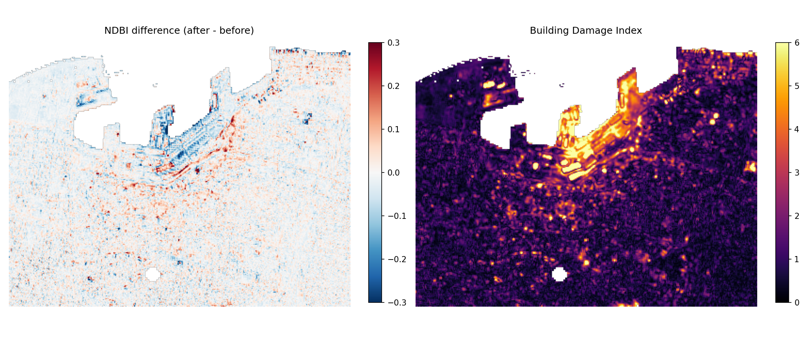
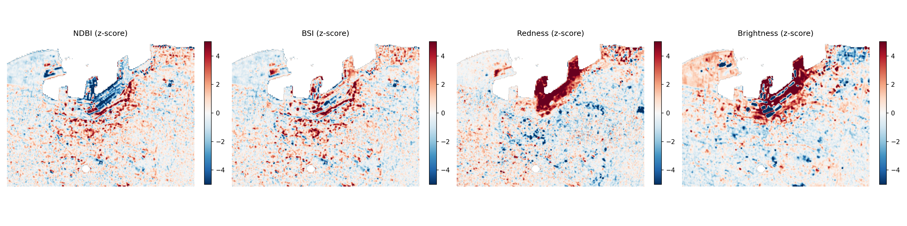

# Beirut Port Explosion Seen from Space

On August 4, 2020, a large stock of ammonium nitrate stored in the port of Beirut exploded. More than 200 people were killed, over 6,000 were injured and around 300,000 people lost their homes. The blast destroyed the port and damaged entire neighbourhoods several kilometres away.

This project uses Sentinel-2 satellite images, freely available through the European Copernicus programme, to detect and map the damage from space by comparing the city before and after the explosion.

*In memory of the victims and their families.*

## Results

### Before and after

| Before | After |
|---|---|
|  |  |

These are natural colour images, close to what the human eye would see from space. On the left, the port is intact with its grain silos and warehouses along the docks. On the right, the central part of the port has turned into a grey, flattened area where most buildings have disappeared.

### Damage map



Each pixel is classified according to how much it changed between the two dates. Red areas show severe damage, orange areas show moderate damage. The most affected zone is the port itself, but many damaged spots are also visible in the residential districts to the south and east.

### Damage on the city



The same classification overlaid on the satellite image after the explosion. It makes it easier to see which parts of the city were hit and how far the damage reached beyond the port.

### Damage and distance from the blast



This chart shows how the amount of damage evolves with the distance from the explosion site.

### A dedicated index for building damage

| NDBI vs BDI | BDI components |
|---|---|
|  |  |

The NDBI is a common index used to detect built-up areas. On its own, it did not show the difference between before and after clearly enough. I built a new index, the BDI, which highlights the destruction of buildings more precisely. The left image compares both indices, the right one shows the bands that make up the BDI.

## Method

1. **Area of interest**: a bounding box around the port of Beirut and the surrounding neighbourhoods, in WGS84 coordinates.
2. **Image search**: Sentinel-2 Level-2A products from the Copernicus Data Space catalogue, filtered to keep only images with less than 10% cloud cover.
3. **Processing**: images are retrieved and processed in the cloud with the Sentinel Hub Process API, using custom evalscripts for true colour composites and spectral indices.
4. **Change detection**: the index is computed on the image before and the image after the explosion. The difference between the two is then split into damage levels using thresholds.

## Tools

Python, Jupyter, sentinelhub, geopandas, shapely, folium, numpy, opencv, Pillow

## How to run it

```bash
git clone https://github.com/Ineshjz/beirut-explosion-sentinel2.git
cd beirut-explosion-sentinel2
pip install sentinelhub geopandas shapely folium numpy opencv-python pillow requests
cp myCopernicusCredentials.example.py myCopernicusCredentials.py
```

1. Create a free account on [Copernicus Data Space](https://dataspace.copernicus.eu).
2. Create an OAuth client in the [Sentinel Hub dashboard](https://shapps.dataspace.copernicus.eu/dashboard/) to get a client ID and a client secret.
3. Fill in `myCopernicusCredentials.py` with your credentials. This file is ignored by Git and should never be shared.
4. Open the notebook and run the cells in order.

## Data

Contains modified Copernicus Sentinel data (2020), processed through the Copernicus Data Space Ecosystem.
